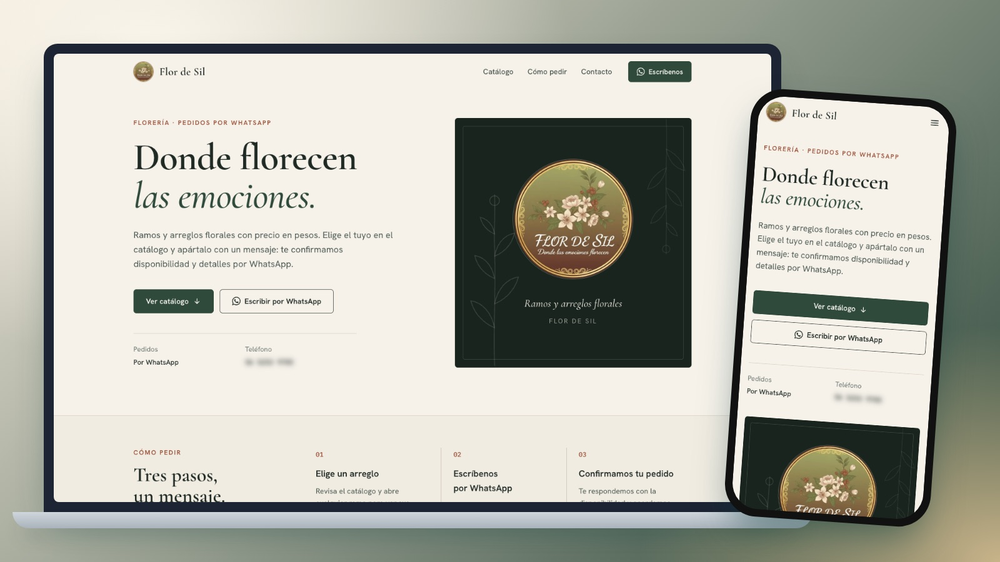
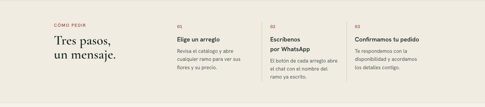
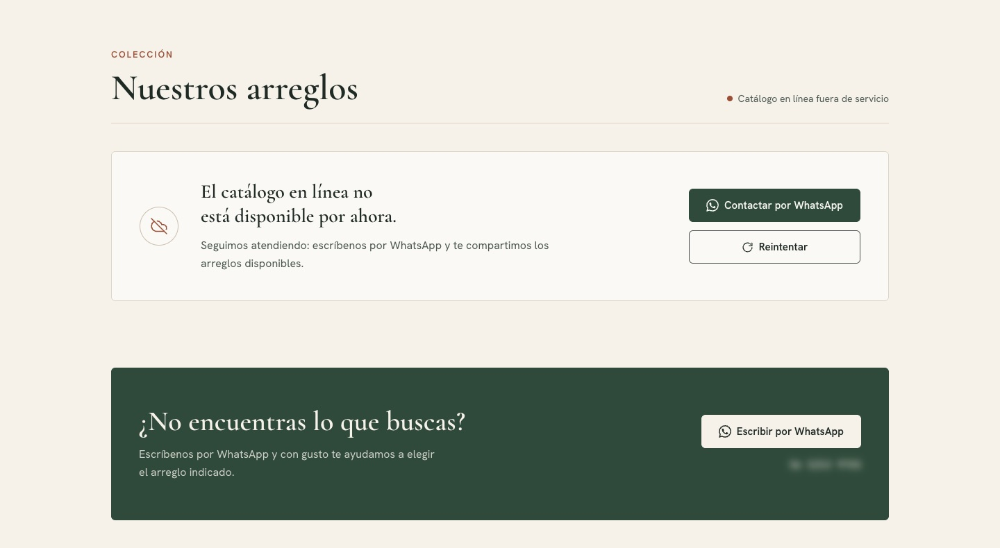
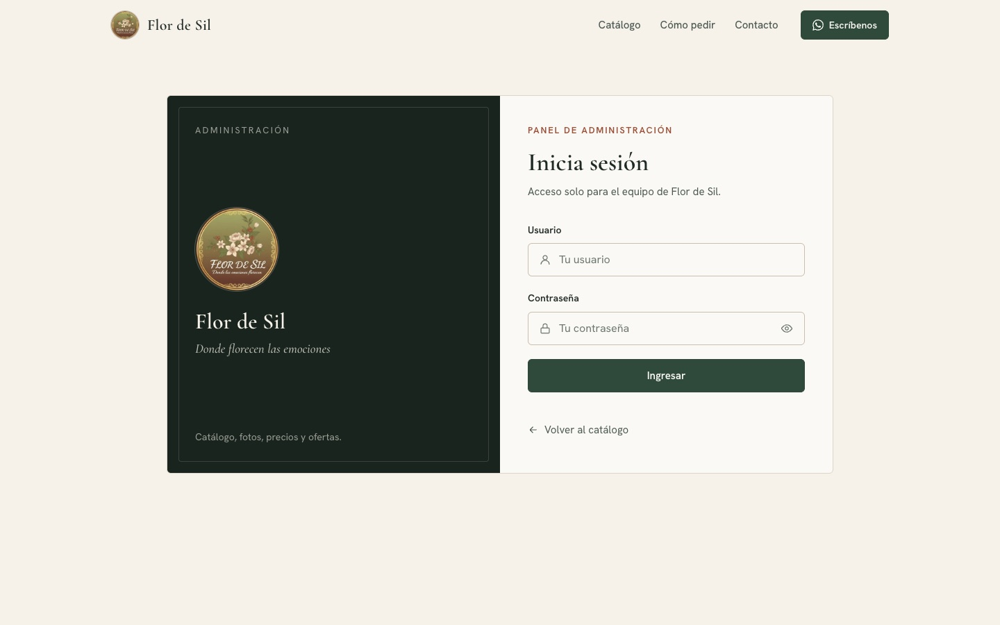
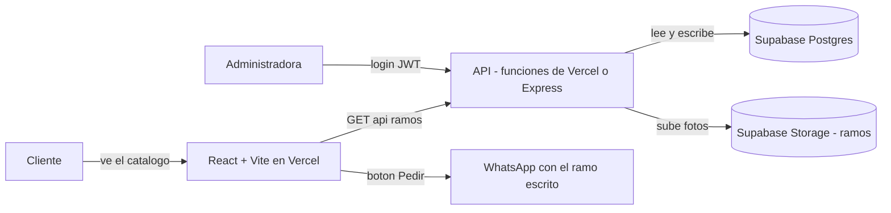

<div align="center">


# Flor de Sil

### Donde florecen las emociones: catálogo web de una florería, con pedidos por WhatsApp y panel de administración.

[](https://flor-de-sil.vercel.app)

[](LICENSE)


<br/>



**[▶ Ver el sitio](https://flor-de-sil.vercel.app)** · **[Cómo funciona](#-cómo-funciona)** · **[Correrlo](#-correrlo-en-tu-compu)**

</div>

> [!NOTE]
> **Estado (nov 2026):** el sitio está en línea, pero **el catálogo no carga** porque la base de datos no responde. La página lo dice con honestidad ("El catálogo en línea no está disponible por ahora") y ofrece contactar por WhatsApp o reintentar. En las capturas el teléfono de la florería aparece difuminado a propósito.

---

## 🎯 El problema

Una florería pequeña vende por WhatsApp: cada cliente pregunta qué arreglos hay, cuánto cuestan y si están disponibles, y la florería responde mandando fotos una por una. No hay un lugar donde ver todo el catálogo ni una forma sencilla de actualizar precios y ofertas.

## 💡 La solución

Un **catálogo web** donde el cliente ve los ramos con foto, flores y precio en pesos, y con un botón abre WhatsApp con el **nombre del ramo ya escrito** ("Hola, me interesa el ramo *…*, ¿está disponible?"). La dueña administra todo desde un **panel privado**: alta de ramos con foto, precio, disponibilidad y promociones.

<div align="center">

</div>

## ✨ Funciones principales

<table>
<tr>
<td width="50%"><br/><b>Catálogo con estado honesto:</b> si la base de datos no responde, el sitio no se rompe: avisa, ofrece WhatsApp y permite reintentar. (Así se ve hoy.)</td>
<td width="50%"><br/><b>Panel de administración</b> (<code>/admin</code>, con <code>noindex</code>): acceso con usuario y contraseña, sesión con JWT.</td>
</tr>
</table>

- **Ramos** con nombre, descripción, lista de flores, precio, foto y disponibilidad.
- **Promociones:** precio de promoción que solo cuenta si es menor al original, editable en una pestaña propia del panel.
- **Fotos** guardadas en Supabase Storage (bucket `ramos`).
- **Pedido por WhatsApp** desde cada tarjeta y desde el detalle del ramo.
- **SEO y compartir:** imagen OG, manifest, `robots.txt`, `sitemap.xml` y `noindex` en el admin.

## 🧠 Cómo funciona



El frontend vive en `client/` y trae sus propias funciones serverless en `client/api/` (login y CRUD de ramos). `server/` es la misma API en Express, pensada para Railway.

<details>
<summary><b>API</b></summary>

| Método | Ruta | Auth | Descripción |
|--------|------|------|-------------|
| POST | `/api/auth/login` | — | Login admin |
| GET | `/api/ramos` | — | Listar ramos |
| POST | `/api/ramos` | JWT | Crear ramo |
| PUT | `/api/ramos/:id` | JWT | Editar ramo |
| DELETE | `/api/ramos/:id` | JWT | Eliminar ramo |

Esquema de la base: [`supabase/schema.sql`](supabase/schema.sql) (tablas `ramos` y `config`, con RLS: lectura pública, escritura solo desde el backend).

</details>

## 🛠️ Stack

| Capa | Tecnología |
|------|-----------|
| Frontend | React 18 + Vite + TailwindCSS · React Router |
| Backend | Funciones serverless de Vercel (`client/api/`) · Node.js + Express (`server/`) |
| Autenticación | JWT (`jsonwebtoken`) |
| Base de datos | Supabase (PostgreSQL) |
| Imágenes | Supabase Storage (bucket `ramos`) |
| Deploy | Vercel (frontend) · Railway (backend Express) |

## 🚀 Correrlo en tu compu

```bash
git clone https://github.com/ALFA117/Flor-de-SIL.git
cd Flor-de-SIL
cd server && npm install
cd ../client && npm install
```

<details>
<summary><b>Configuración paso a paso</b></summary>

1. **Variables de entorno:** copia `server/.env.example` a `server/.env` y `client/.env.example` a `client/.env`. Define **tus propios** `JWT_SECRET`, `ADMIN_USER` y `ADMIN_PASSWORD` (no uses los valores de ejemplo) y agrega tu `SUPABASE_URL` y `SUPABASE_SERVICE_ROLE_KEY` (esta última solo en el servidor).
2. **Supabase:** en el SQL Editor ejecuta `supabase/schema.sql`; en Storage crea el bucket `ramos` como **Public**.
3. **Levantar:**

   ```bash
   # Terminal 1 (backend)
   cd server && npm run dev     # http://localhost:4000

   # Terminal 2 (frontend)
   cd client && npm run dev     # http://localhost:5173
   ```

4. Panel de administración: `http://localhost:5173/admin/login`, con el usuario y contraseña que definiste.

**Deploy:** Vercel con root `client` (variables `VITE_API_URL`, `VITE_SUPABASE_URL`, `VITE_SUPABASE_ANON_KEY`) y, si usas el backend Express, Railway con root `server` y `CLIENT_URL` apuntando a Vercel.

</details>

## 📄 Licencia

[MIT](LICENSE)

---

<div align="center">

<sub>Hecho por <a href="https://github.com/ALFA117">ALFA117</a> para Flor de Sil · <i>Donde florecen las emociones</i></sub>

</div>
